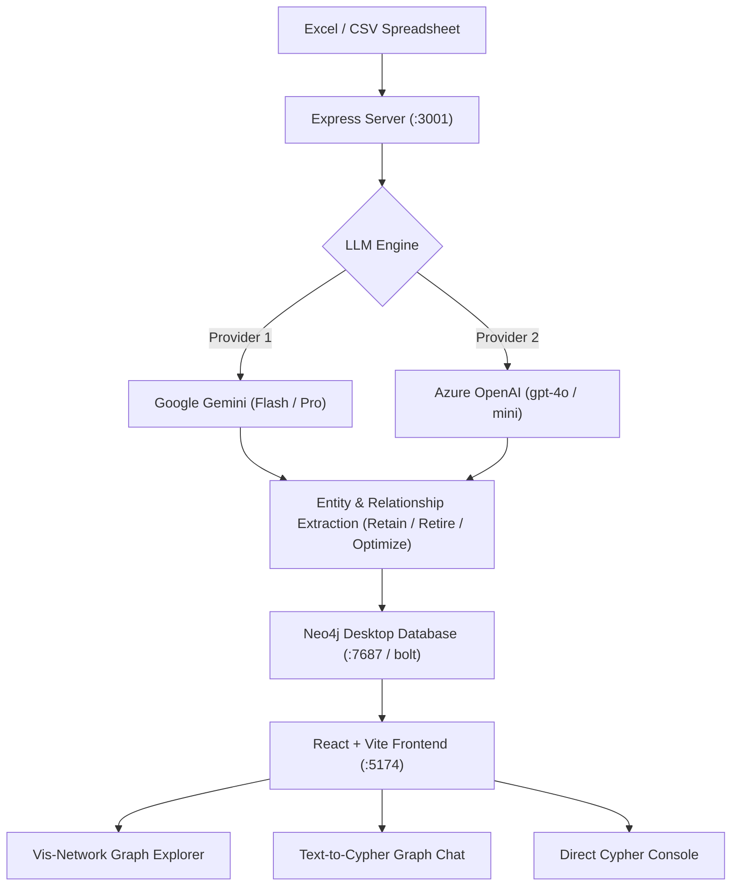

# Enterprise Graph Architect • Neo4j & LLM Rationalization

An AI-powered Enterprise Application Stack Rationalization platform that converts application portfolio spreadsheets (Excel `.xlsx`, `.xls`, `.csv`) into an interactive **Neo4j Knowledge Graph**, classifies systems into **Retain**, **Retire**, and **Optimize**, and allows conversational natural language **Chat with the Graph** powered by **Azure OpenAI** or **Google Gemini**.

---

## 🌟 Key Features

1. **Dual LLM Provider Support (Azure OpenAI & Google Gemini)**
   - Toggle between **Google Gemini** (1.5 Flash, 1.5 Pro, 2.0) and **Azure OpenAI** (`gpt-4o`, `gpt-4o-mini`).
   - Configure endpoints, keys, deployments, and models directly from the UI or via environment variables.
   - Built-in architectural reasoning engine for instant testing even without external API keys.

2. **Excel Ingestion & Knowledge Graph Construction**
   - Modeled after the `neo4j-graph-builder` architecture.
   - Analyzes application attributes (annual maintenance spend, technical debt, cloud readiness, criticality, user count).
   - Extracts nodes: `(:Application)`, `(:Classification {name: 'RETAIN' | 'RETIRE' | 'OPTIMIZE'})`, `(:Department)`, `(:Technology)`, `(:Vendor)`, `(:Platform)`.
   - Maps relationships: `[:CLASSIFIED_AS]`, `[:OWNED_BY]`, `[:USES_TECH]`, `[:HOSTED_ON]`, `[:PROVIDED_BY]`, `[:DEPENDS_ON]`.
   - Includes a 1-click **Enterprise Application Stack (20 Systems)** sample dataset for immediate testing.

3. **Interactive Knowledge Graph Explorer**
   - Built with `vis-network` with smooth physics simulation and organic clustering.
   - Color-coded nodes (🟢 Retain, 🔴 Retire, 🟡 Optimize, 🔵 Department, 🟣 Tech Stack).
   - Search & focus, zoom/pan controls, and classification filtering.
   - **Node Inspector Drawer**: Inspect annual maintenance costs, active users, LLM rationalization justification, and action plans.

4. **Conversational Graph Chat (Text-to-Cypher AI)**
   - Ask natural language questions like:
     - *"Which applications should we retire first to save maximum budget?"*
     - *"Show all systems in Finance & Accounting with high maintenance cost"*
     - *"What applications depend on legacy AS400 or mainframe systems?"*
   - Translates questions into read-only Cypher queries (`MATCH ... RETURN ...`), runs them in Neo4j, and generates executive answers.
   - Interactive **Spotlight Chips**: Click any application in the chat response to focus on it in the graph.

5. **Direct Cypher Console**
   - Execute custom Cypher queries directly against your connected Neo4j database.

---

## 🏗️ Architecture



---

## 🚀 Quick Start

### Prerequisites
- [Node.js](https://nodejs.org/) v18 or higher
- [Neo4j Desktop](https://neo4j.com/download/) (running on `bolt://localhost:7687`)

### 1. Clone the Repository
```bash
git clone https://github.com/rahulbalhotra/Neo-chat-Assist.git
cd Neo-chat-Assist
```

### Quick Start (Windows 1-Click)
Simply double-click `start.bat` or run:
```cmd
start.bat
```
This automatically verifies Node.js, installs root and client dependencies, generates sample datasets, starts both servers, and opens `http://localhost:5174/` in your browser.

---

### Manual Setup
```bash
# Install root & backend dependencies
npm install

# Install client dependencies
cd client
npm install
cd ..
```

### 3. Configure Environment (Optional)
Copy `.env.example` to `.env` or configure directly in the UI Settings modal:
```bash
cp .env.example .env
```

### 4. Run Locally
Start both backend and frontend concurrently:
```bash
npm run dev
```

- **Frontend Application**: `http://localhost:5174/`
- **Backend API**: `http://localhost:3001/`

---

## 📂 Project Structure

```text
├── server/
│   ├── index.js                     # Express server & API routes
│   ├── generateSampleExcel.js       # Enterprise sample spreadsheet generator
│   └── services/
│       ├── neo4jService.js          # Neo4j driver, Cypher execution & schema
│       ├── llmService.js            # Unified Azure OpenAI & Gemini client
│       ├── graphBuilderService.js   # Excel-to-Graph extraction pipeline
│       └── graphChatService.js      # Text-to-Cypher & Graph RAG
├── client/
│   ├── index.html                   # HTML entry point with fonts & metadata
│   ├── vite.config.js               # Vite configuration & backend proxy
│   └── src/
│       ├── App.jsx                  # Main application orchestrator
│       ├── index.css                # Clean white theme styling
│       ├── components/
│       │   ├── Header.jsx           # Model switcher & connection status
│       │   ├── PortfolioSummary.jsx # KPI cards (Total Apps, Retain, Retire, Spend)
│       │   ├── ExcelUploader.jsx    # File dropzone & execution logs
│       │   ├── GraphViewer.jsx      # Vis-network interactive graph explorer
│       │   ├── GraphChat.jsx        # Conversational Text-to-Cypher chat
│       │   ├── NodeDetailsModal.jsx # Application properties inspector drawer
│       │   └── ConfigModal.jsx      # Model & Neo4j credentials configuration
│       └── services/
│           └── api.js               # Frontend API client
├── sampleData/
│   └── enterprise_application_stack.xlsx # 20-app sample portfolio dataset
├── package.json
└── README.md
```

---

## 📄 License
ISC License
